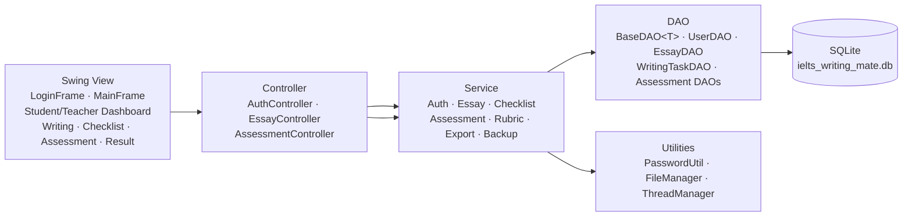
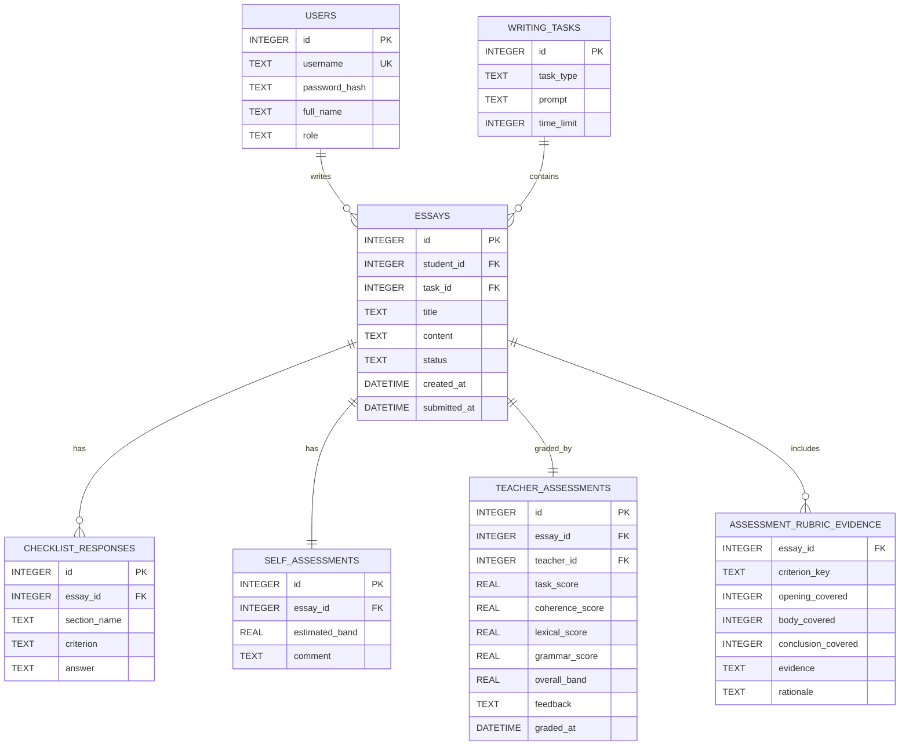
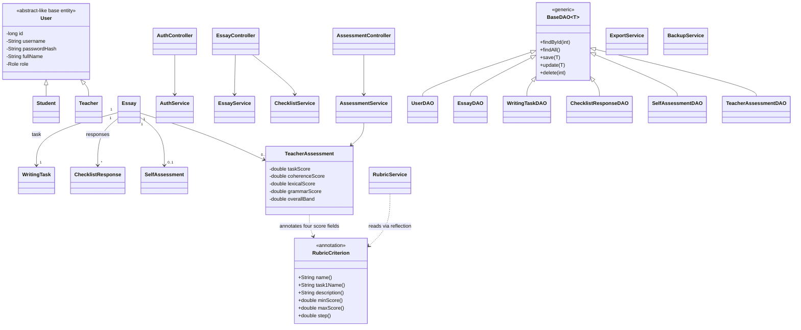

  # IELTS Writing Mate

Ứng dụng desktop Java Swing với giao diện FlatLaf Light/Dark, hỗ trợ học sinh luyện IELTS Writing, tự đánh giá bằng checklist và giáo viên chấm theo bốn tiêu chí IELTS. Dữ liệu được lưu cục bộ bằng SQLite.

## Yêu cầu

- JDK 21
- Apache Maven 3.8 trở lên
- Windows, macOS hoặc Linux có môi trường desktop để chạy giao diện Swing

## Build và chạy

Mở terminal tại thư mục chứa `pom.xml`:

```shell
mvn clean package
java -jar target/ielts-writing-mate-1.0-SNAPSHOT.jar
```

Maven biên dịch với Java release 21, chạy unit test JUnit 5 và đóng gói dependency vào executable JAR. SQLite được khởi tạo và seed dữ liệu demo khi ứng dụng mở lần đầu. File `ielts_writing_mate.db` được tạo trong thư mục làm việc hiện tại; hãy chạy ứng dụng từ thư mục mong muốn để chọn vị trí lưu database.

Giao diện dùng FlatLaf Light mặc định. Để chạy với giao diện tối:

```shell
java -Dieltsmate.theme=dark -jar target/ielts-writing-mate-1.0-SNAPSHOT.jar
```

## Tài khoản demo

Mật khẩu mặc định cho cả ba tài khoản là `123456`.

| Vai trò | Tên đăng nhập | Mật khẩu |
|---|---|---|
| Giáo viên | `teacher1` | `123456` |
| Học sinh | `student1` | `123456` |
| Học sinh | `student2` | `123456` |

Các tài khoản chỉ được tạo khi bảng `users` chưa có dữ liệu. Mật khẩu trong seed được lưu dưới dạng BCrypt hash.

## Chức năng theo vai trò

- **Học sinh:** chọn Task 1/Task 2, tạo và lưu nháp essay, nộp bài, xuất TXT UTF-8, hoàn thành checklist, lưu band tự ước tính/nhận xét, xem kết quả đã chấm, backup và restore essay.
- **Giáo viên:** lọc các bài `SUBMITTED`/`GRADED`, mở bài, chấm bốn tiêu chí theo bước 0.5, xem overall band tính tự động, lưu đánh giá hoặc hoàn tất chấm.
- Rubric chấm tách Task Achievement (Academic Task 1) và Task Response (Task 2), cùng Coherence & Cohesion, Lexical Resource và Grammatical Range & Accuracy. Teacher Rubric Checklist được nhóm theo Introduction, Body paragraphs và Conclusion/Overview; mỗi tiêu chí có band anchors tóm lược 5–8, Evidence và Rationale bắt buộc. Overall Band chỉ hiện sau khi cả bốn tiêu chí có score, indicator được chọn, evidence và rationale. Evidence/rationale được lưu theo essay và tiêu chí.
- Thao tác đọc/ghi dữ liệu và file trên giao diện chạy nền; kết quả được cập nhật trên Swing Event Dispatch Thread.

## Đối chiếu tiêu chí nghiệm thu

| AC | Tiêu chí | Thành phần đáp ứng |
|---|---|---|
| AC01 | Đăng nhập và điều hướng theo role | `LoginFrame`, `AuthController`, `AuthService`, `MainFrame` |
| AC02 | Học sinh xem đề Task 1 và Task 2 | `StudentDashboardPanel`, `WritingTaskService`, `WritingTaskDAO` |
| AC03 | Tạo essay mới | `StudentDashboardPanel`, `EssayController`, `EssayService` |
| AC04 | Lưu và mở lại bản nháp | `WritingPanel`, `EssayService`, `EssayDAO` |
| AC05 | Essay đã nộp không còn sửa được | `EssayService`, `WritingPanel` |
| AC06 | Checklist lưu theo essay/section | `ChecklistPanel`, `ChecklistService`, `ChecklistResponseDAO` |
| AC07 | Lưu self-assessment | `ChecklistPanel`, `ChecklistService`, `SelfAssessmentDAO` |
| AC08 | Giáo viên xem bài đã nộp | `TeacherDashboardPanel`, `EssayService` |
| AC09 | Giáo viên chấm bốn tiêu chí, đối chiếu indicator/descriptor và lưu evidence/rationale | `AssessmentPanel`, `RubricService`, `RubricEvidenceDAO`, `AssessmentService` |
| AC10 | Tính overall band theo quy tắc IELTS | `AssessmentService.calculateOverallBand()` |
| AC11 | Học sinh xem band và feedback | `ResultPanel`, `AssessmentService` |
| AC12 | Xuất essay TXT UTF-8 | `WritingPanel`, `ExportService`, `FileManager` |
| AC13 | Backup/restore essay bằng serialization | `StudentDashboardPanel`, `BackupService`, `FileManager` |
| AC14 | Dữ liệu tồn tại qua các lần mở ứng dụng | SQLite, `DatabaseConnection`, các DAO |

## Kiến trúc



## ERD



## UML Class



## Kiểm thử

Chạy toàn bộ test:

```shell
mvn test
```

Các test JUnit 5 bao phủ xác thực tài khoản, làm tròn band và rubric annotation, vòng đời essay, quyền sở hữu essay, xuất TXT và backup/restore.